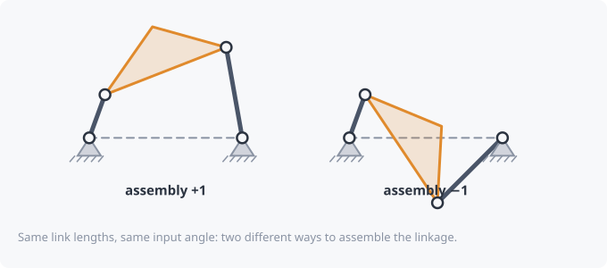

# Assemblies and circuits

## Two ways to put it together

Take the four link lengths and hold the input at some angle. There are
usually **two** ways to connect the coupler and output: the joint between
them can sit on either side of the line from the input pin to the output
pivot.

kinsyn calls these **assembly +1** and **assembly −1** (the *Assembly*
setting). Same parts, different mechanism. You can't get from one to the
other without taking the linkage apart, except at special positions where
the two meet.

## Circuits

A **circuit** is one continuous cycle the linkage can run through without
being disassembled.

- A **Grashof crank** has two separate circuits, one for each assembly.
  kinsyn draws the one you're on solid and the other dashed.
- With a **rocking input**, the linkage reaches a limit where it
  momentarily lines up, then comes back on the *other* assembly. Both
  halves together make one closed circuit.
- At a **change point**, the two assemblies cross. A general change-point
  linkage switches assembly each time it passes through, so its motion
  only repeats every **two** input turns.

## Why you should care

When you design a mechanism to pass through several positions, all of them
must be on **the same circuit**, and ideally in the right order. Otherwise
the real linkage can't get from one to the next. These problems are
called *circuit / branch / order defects*, and kinsyn's solvers will check
for them automatically.

Related: [Grashof condition](grashof.md) · [Kinematic synthesis](synthesis.md)
