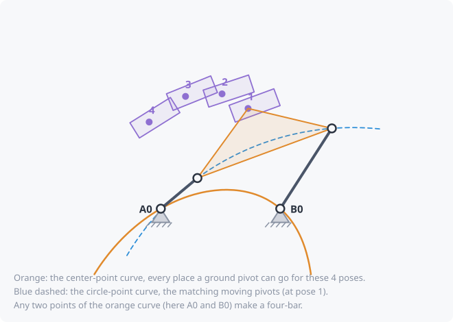

# Burmester curves and points (4 and 5 poses)

With 2 or 3 poses you can put a ground pivot almost anywhere and find a
link that works (see [Kinematic synthesis](synthesis.md)). Each extra pose
takes away freedom:

| Poses | Where a ground pivot can go |
|---|---|
| 3 | almost anywhere |
| 4 | only on one curve, the **center-point curve** |
| 5 | only at a few points, the **Burmester points** (0, 2 or 4 of them) |
| 6 or more | in general nowhere: an optimizer finds the closest fit instead |

They are named after Ludwig Burmester, who worked this out in the 1880s.

## The center-point curve (4 poses)

- Every point of the **center-point curve** (orange) is a ground pivot
  that works: there is a point on the moving part that stays the same
  distance from it in all 4 poses.
- That point on the part is the **moving pivot**. Together the moving
  pivots form the **circle-point curve** (blue dashed), drawn where they
  are in pose 1.
- **Any two points** of the center-point curve make a four-bar: one is the
  input side, the other the output side.

The curve often runs off to infinity. A ground pivot "at infinity" means
the link becomes a straight **slider rail**, so the directions where the
curve leaves are where a slider works. kinsyn finds those directions
exactly and offers them as slider-crank options (pink on the canvas).
For a slider, the moving pivot is a **Ball point**: a point of the part
whose 4 positions lie on one straight line.

## Burmester points (5 poses)

For 5 poses, a ground pivot has to be on the curve for poses 1-2-3-4
*and* on the curve for poses 1-2-3-5. The curves cross at a few points
(gold stars on the canvas); some crossings are always there and
meaningless, so kinsyn checks each one against all 5 poses.

- **4 real points**: up to 12 four-bars (each pair, with either side as
  the input).
- **2 real points**: one four-bar, driven from either side.
- **0 real points**: no pin-jointed four-bar passes exactly through these 5
  poses. Moving one pose a little can change that.

## In kinsyn

- The curves are drawn on the canvas while the **Synthesis** tab is
  solving 4 or 5 poses. Stretches used by at least one valid design are
  drawn thick and **green**: those are the usable parts.
- To choose a pivot yourself, place a **fixed pivot** (Pivot tool, **G**).
  It snaps onto the curve when you place or drag it near it. If it is a
  little off the curve, designs use the nearest point on the curve; with
  5 poses, the nearest Burmester point.
- Every design is still checked for [defects](synthesis.md), transmission
  angle and your other limits. Many textbook Burmester solutions fail
  those checks, and the **Rejected** tab says why.

See the [motion generation tutorial](../tutorials/04-motion-generation.md).
