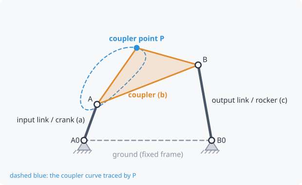

# Coupler point and coupler curve

A **coupler point** (P) is any point fixed to the coupler. It doesn't have
to lie on the line between the pins; it can sit off to the side, as if the
coupler were a triangular plate. As the linkage moves, P traces the
**coupler curve** (blue in kinsyn).

Coupler curves come in a huge variety of shapes: ovals, figure-eights,
teardrops, curves with nearly straight stretches (used for straight-line
motion) and curves with nearly circular stretches (used for dwells, where
a follower pauses). The classic reference, the Hrones–Nelson atlas, is a
book of over 7,000 of them.

## How it's defined in kinsyn

"Coupler point P" in the Mechanism tab is given in the **coupler's own
frame**:

- **x** runs along the coupler from joint A towards joint B;
- **y** is measured to the left of that line.

So P = (b/2, 0) is the midpoint of the coupler, and P = (b/2, 30) is 30
units off to one side of the midpoint.

## Coupler point speed and acceleration

The plots can show how fast P moves along its curve (**coupler point
speed**) and how hard it's being accelerated (**coupler point
acceleration**). Acceleration peaks where the curve turns sharply or has a
cusp. That's where a part carried by the coupler feels the largest
inertia forces. See [Velocity and acceleration](velocity-acceleration.md).

Related: [Kinematic synthesis](synthesis.md) (designing the linkage so P
follows the path you want)
