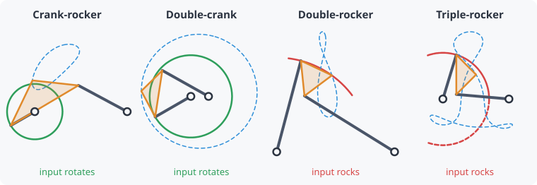

# Grashof condition

**Which links can turn all the way round?** The Grashof condition answers
this from the four link lengths alone.

Call the shortest link **s**, the longest **l**, and the other two
**p** and **q**.

- **s + l < p + q** (Grashof): at least one link can make full turns.
- **s + l > p + q** (non-Grashof): no link can. Everything only rocks.
- **s + l = p + q** (change point): on the boundary. The linkage can
  line up completely and then carry on in either
  [assembly](assemblies-and-circuits.md), so it needs a guide or a stop.

For a Grashof linkage, **which link is shortest** decides the type:

| Shortest link | Type | Motion |
|---|---|---|
| Input | **Crank-rocker** | Input turns fully, output swings. The most common: a motor turning a wiper. |
| Ground | **Double-crank (drag link)** | Both turn fully, at an uneven speed ratio. |
| Coupler | **Double-rocker** | Both grounded links swing, while the coupler can turn over. |
| Output | **Rocker-crank** | Input swings, output turns fully (like a treadle). |

## Does it matter?

Only if you need the input to turn continuously, for example when a motor
drives it. If the input is a handle, lever or cylinder that swings back
and forth anyway, a non-Grashof linkage is perfectly fine. kinsyn then
shows the input's **swing range** (between its two
[toggle](toggle-over-center.md) limits).

## In kinsyn

The **Class** line in the analysis summary gives the type, and the notes
show the s + l vs p + q comparison. Slider mechanisms have their own
version of the rule. For a slider-crank, the crank turns fully when
b ≥ a + |e|. See [Slider mechanisms](slider-mechanisms.md).
