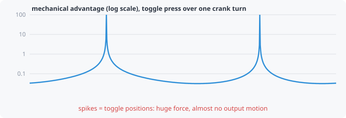

# Mechanical advantage

**How much force do you get out for the force you put in?**

For an ideal, frictionless mechanism, energy in equals energy out:

> input force × input movement = output force × output movement

So wherever the output moves **slowly** compared with the input, the output
force is **large**. Mechanical advantage (MA) is that ratio: output force
(or torque) per unit input force (or torque).

- **MA > 1**: force is multiplied, but the output moves less.
- **MA < 1**: speed and travel are multiplied, but force is reduced.
- **MA → ∞** at a [toggle](toggle-over-center.md): the output stops
  moving, so in theory any force can be resisted.

## Units

If the input and output are the same kind (both rotating, or both
sliding), MA has no units. If one rotates and the other slides, MA carries
a length unit: for example, torque needed per unit of slider force is a
lever arm. The plot title says which.

## In kinsyn

Choose **Mechanical advantage** in any plot's dropdown (log scale). The
readout next to the scrub bar shows the current value, or **∞ (toggle)**.
Real mechanisms have friction, so treat very large values as "very high"
rather than literally infinite.
