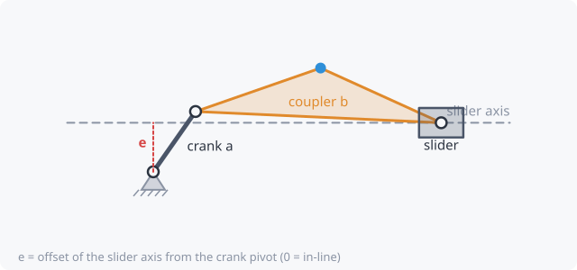

# Slider mechanisms

Replace one pin of a four-bar with a **slider** (a block moving in a
straight guide) and you get the slider family. It's just as common as the
four-bar: engines, pumps, presses, cylinders.

| Mechanism | What moves | Typical use |
|---|---|---|
| **Slider-crank** | crank turns, slider goes back and forth | engines, compressors, pumps, presses |
| **Offset slider-crank** | same, with the slider's line shifted by **e** | mild quick return |
| **Slider-driven crank** | a linear input (actuator, ram) turns a crank | linear actuators driving levers |
| **Inverted slider-crank / oscillating cylinder** | a pivoting cylinder pushes a lever | excavators, loaders, tailgates |
| **Whitworth / crank-shaper** | a crank pin slides in a slotted lever | quick-return drives |
| **Scotch yoke** | a pin in a slot drives a yoke | exact simple-harmonic motion |
| **Elliptical trammel** | two sliders on crossed guides | every point traces an ellipse |

## Key dimensions

- **Crank a** and **coupler b**, as in a four-bar.
- **Slider axis angle**: the direction the slider travels.
- **Offset e**: perpendicular distance from the crank pivot to the slider's
  line. With e = 0 it's *in-line*.
- **Stroke**: how far the slider travels. For an in-line slider-crank the
  stroke is 2a.

## Full rotation

A slider-crank's crank turns fully when **b ≥ a + |e|**. That's the slider
version of the [Grashof condition](grashof.md).

## Input choice

Some slider mechanisms can be driven either way. Set **Input** to *crank*
or *slider* / *stroke*. For a cylinder, the input is its length, so set an
**operating range** matching the cylinder's retracted and extended lengths.
