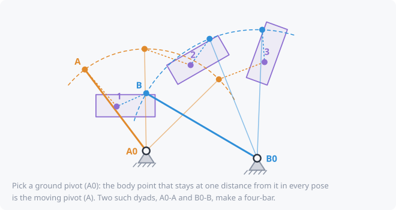

# Kinematic synthesis

**Analysis** asks: *given this linkage, how does it move?*
**Synthesis** asks the reverse: *given the motion I need, what linkage
produces it?* That's what kinsyn is built for.

## Three kinds of problem

| Type | You specify | Example |
|---|---|---|
| **Motion generation** | **poses** (position + angle) the moving part must reach | a hood that must lift and tilt to clear the windshield |
| **Path generation** | **points or a curve** a point must travel along | a feeder claw that must trace a D-shaped path |
| **Function generation** | how the **output angle** must depend on the input angle | a mechanical calculator, a throttle linkage |

## Precision points vs. approximation

- A keyframe with **zero tolerance** is a **precision point**: the
  mechanism must pass through it *exactly*.
- Exact methods can handle only a few precision points: up to **5 poses**
  for motion generation with a four-bar. With more, or with tolerances,
  kinsyn uses an **optimizer**, which finds the linkage that comes closest.

The hint at the top of the Target tab tells you which applies:

| Your target | Method |
|---|---|
| 2 poses | many solutions; you choose the free parameters |
| 3 poses | dyad solve (a small linear system) |
| 4 poses | **Burmester curves**: every point on the curve is a valid pivot |
| 5 poses | **Burmester points**: a handful of exact solutions |
| more, or with tolerance | optimization |

## Timing

By default the solver decides *when* (at what input angle) each keyframe
is reached: **free timing**. Fixing the timing makes the problem much
harder, so use it only where it truly matters.

## Dyads: how 2 and 3 poses are solved

A four-bar is two **dyads** joined by the moving part. A dyad is one
ground pivot, one link, and one joint on the part. Each side can be
designed on its own:

- **Pin dyad**: pick a ground pivot. For 3 poses there is exactly one
  point on the part that stays the same distance from it in every pose.
  That point is the moving pivot, and the distance is the link length.
- **Slider on the ground**: pick the direction of a straight rail. There
  is one point on the part whose 3 positions lie on a line in that
  direction. A slider block goes there.
- **Swivel**: pick a direction along the part. There is one ground point
  that the part can slide through in all 3 poses (a slotted lever, or a
  rod through a pivoting block or cylinder).

So each side has a free choice. kinsyn tries many of them, pairs up the
dyads, and checks every result. With 2 poses there is even more freedom;
with 4 and 5 poses the choices shrink to curves and then to a handful of
points: see [Burmester curves and points](burmester.md).

## After solving

Every candidate is then checked by running the full analysis on it:

- it really passes through every pose (a round trip, to catch mistakes);
- no **defects** (below);
- [transmission angle](transmission-angle.md) between the first and last
  pose;
- [Grashof class](grashof.md), if you asked for full rotation or a
  particular class;
- not at the change point;
- link length ratio, and ground pivots inside your allowed zones.

Candidates that fail are listed in the **Rejected** tab with the reason,
so you can see why they were ruled out.

## Defects

A textbook solution can pass through every pose and still be useless.
These are the classic ways that happens:

- **Branch defect**: most linkages can be put together in two ways, its
  two [assemblies](assemblies-and-circuits.md). If some poses are reached
  in one and the rest in the other, the real linkage can't get from one
  to the other without being taken apart.
- **Order defect**: it reaches every pose, but not in your order. For
  example, it passes pose 3 on the way from pose 1 to pose 2.
- **Circuit defect**: the poses lie on separate pieces of the motion
  (separate [circuits](assemblies-and-circuits.md)), so the input can't
  move from one to the next at all.

For an input that rocks, kinsyn also requires the poses to lie within a
single swing between the two [toggle](toggle-over-center.md) positions.

See the [motion generation tutorial](../tutorials/04-motion-generation.md)
to try it.
