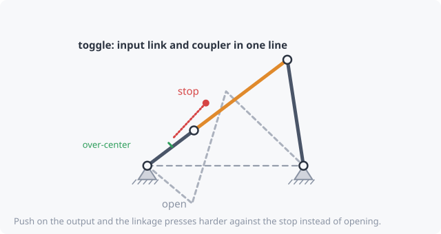

# Toggle and over-center

## Toggle

A **toggle** is the position where the input link and coupler **line up**
(fully stretched out or fully folded). At that instant:

- the output stops and reverses, because it has reached the end of its
  swing;
- a tiny movement of the input produces almost no output movement;
- so the force multiplication, the
  [mechanical advantage](mechanical-advantage.md), becomes enormous.

This is how toggle clamps, toggle presses, rivet squeezers and stone
crushers produce huge forces from a small push.

## Over-center

If the input moves **a few degrees past** the toggle and then rests
against a **stop**, the load on the output now pushes the input *further
into* the stop, not back out. The mechanism **locks**. That's an
over-center latch, as in toggle clamps, folding table legs, and
hood and tailgate latches. To release it, you pull the handle back
through the toggle.

Typical over-center amount: **2° to 5°**. Too little and vibration can
unlatch it; too much and it becomes hard to open.

## In kinsyn

- Toggle positions are listed in the summary and marked with a red **×**
  on the coupler curve.
- Tick **Limit input to an operating range** and set it from the open
  position to the stop. If a toggle lies inside that range, the summary
  reports **"Over-center: 4.8° past toggle"**.
- Templates to start from: **Toggle clamp** (four-bar) and **Toggle press
  / latch** (slider), under *Over-center / toggle* in the Library.
