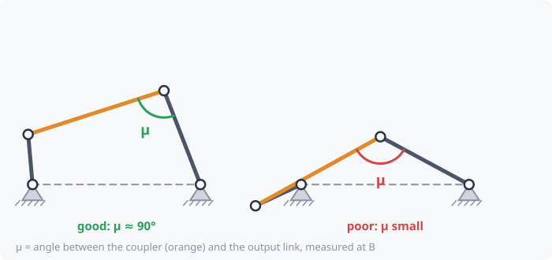

# Transmission angle

**Will the linkage push well, or will it bind?**

The transmission angle **μ** is the angle between the **coupler** and the
**output link**, measured at the joint where they meet.

The coupler can only push or pull along its own length. Only the part of
that force that is *perpendicular* to the output link turns it. That part
is largest when μ = 90°.

- **μ near 90°**: almost all the force goes into moving the output.
- **μ near 0° or 180°**: the coupler pushes almost straight along the
  output link, so almost none of the force turns it. Friction wins, the
  linkage jams or chatters, and the joints wear.

## Rule of thumb

Keep μ between **40° and 140°** over the whole motion (even more margin
for high speeds or heavy loads). kinsyn marks the bad bands in red on the
transmission-angle plot. The limit (40° by default) can be changed in
**Edit → Preferences**.

## In kinsyn

- **Summary:** "Transmission angle: 51° to 64°, worst 51°". The worst value
  is shown green if it's inside the limit and red if not.
- **Plot:** transmission angle over the cycle, with the forbidden bands
  shaded.
- **Readout:** the μ value next to the scrub bar at the current position.

For sliders the idea is the same: the angle between the coupler and the
direction the slider can move.

Related: [Mechanical advantage](mechanical-advantage.md) ·
[Toggle and over-center](toggle-over-center.md)
