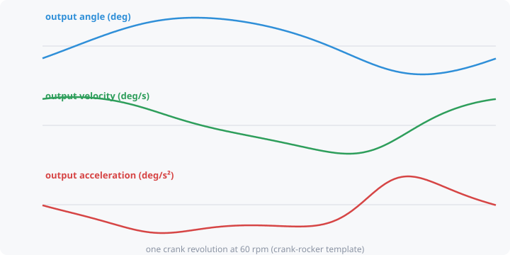

# Velocity and acceleration

Even when the input turns at a perfectly **steady** speed, the output of
most linkages does not move steadily. It speeds up, slows down, stops and
reverses. How it does that matters as much as *where* it goes.

- **Position**: where the output is (an angle or a slider distance).
- **Velocity**: how fast it's moving. Zero where the output reverses
  (the ends of its swing).
- **Acceleration**: how quickly the velocity changes. By Newton's law
  (F = m·a), this is what sets the **inertia forces**. High acceleration
  means large shaking forces, noise, vibration, wear, and parts trying to
  fly off.

## Coupler point speed and acceleration

The same ideas apply to the [coupler point](coupler-point.md) moving
along its curve:

- **Coupler point speed** is how fast P travels along its path. For
  example, a conveyor-feed claw should move slowly while it grips.
- **Coupler point acceleration** is how hard P is being thrown around. It
  peaks at sharp turns and cusps of the coupler curve, which is where a
  part carried by the coupler feels the largest force.

## Input speed

These values scale with the input speed. Set it in the **Motion** box (rpm
for a rotating input, length per second for a slider or cylinder).
Doubling the speed doubles velocities and **quadruples** accelerations.

## In kinsyn

Pick **Output velocity**, **Output acceleration**, **Coupler point speed**
or **Coupler point acceleration** from any plot's dropdown. For a rocking
input, kinsyn assumes the input reverses instantly at the ends of its
range, which shows up as spikes at those points. A real drive slows down
smoothly there.

Planned: drag these curves into the shape you want and let kinsyn find a
mechanism that produces them.
