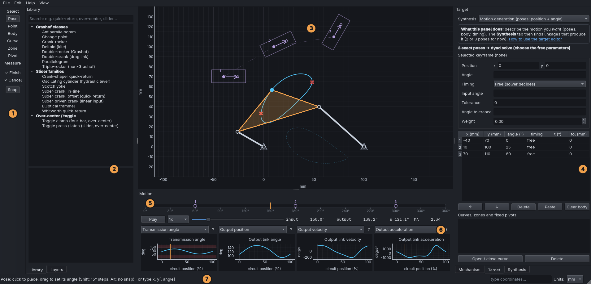

# Tour of the window

1. **Tools** (left edge): Select, Pose, Point, Body, Curve, Zone, Pivot
   and Measure, plus Finish / Cancel while drawing a shape, and Snap on/off.
2. **Library / Layers** (left panel):
   - **Library** has ready-made mechanisms to learn from and start with.
   - **Layers** holds reference images and DXF drawings (underlays) to
     trace over.
3. **Canvas** (centre): the mechanism and your target motion. Scroll to
   zoom, drag empty space to pan, and press **F** to fit everything in view.
4. **Mechanism / Target / Synthesis** (right panel):
   - **Mechanism** shows the current linkage's dimensions (with sliders)
     and its analysis summary.
   - **Target** is where you describe the motion you want.
   - **Synthesis** finds linkages that produce it.
5. **Timeline**: one turn of the input, with a marker for each keyframe.
   The orange line is where the animation is now.
6. **Playback and plots**: play / pause (**Space**), speed, a scrub bar,
   and four plots. Each plot has a dropdown to choose what it shows.
7. **Status bar**: tells you what the current tool expects. You can type
   exact coordinates into the box at the bottom. The **Units** menu is on
   the right.

Everything is saved in a project file (**File → Save project**, Ctrl+S).

**Next:** [Explore a template](02-explore-a-template.md)
