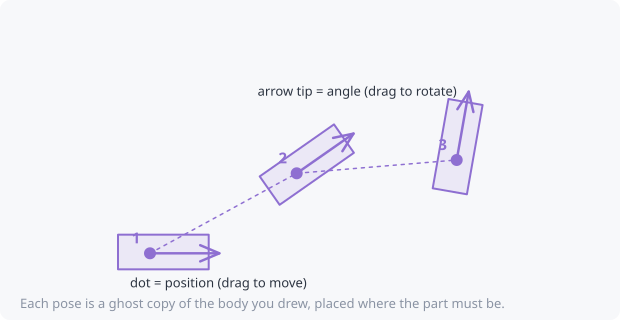
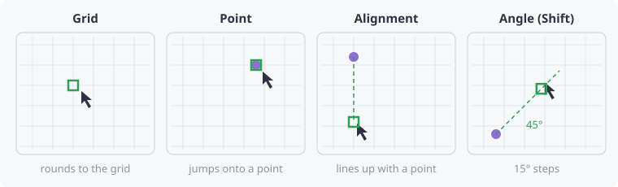
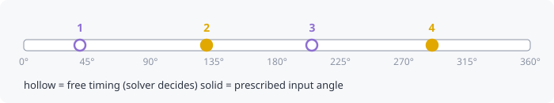

# Define a motion: poses, body, curves and snapping

The **Target** is the motion you *want*. The **Synthesis** tab then finds
linkages that produce it: see
[Find a linkage through 2 to 5 poses](04-motion-generation.md). While you set
up the target, you can hide the mechanism with **View → Show mechanism**.

Start with **File → New project** for a clean canvas.

## Poses: where the part must be (motion generation)

A **pose** is a position *and* an angle that the moving part must reach.

1. Choose the **Pose** tool (**P**).
2. **Click** to place a pose, or **press and drag** to place it and set its
   angle in one go.
3. Place 2 to 5 poses in the order the part should visit them. The
   numbers show the order.

Change them with the **Select** tool (**V**):

- drag the **dot** to move a pose;
- drag the **arrow tip** to rotate it;
- press **Delete** to remove the selected pose.

Every change can be undone (**Ctrl+Z**).

## Body: what the moving part looks like

1. Choose the **Body** tool (**B**).
2. Click around the outline of the part (a door, a jaw, a flap).
3. **Finish** in any of these ways:
   - click the **first point** again (closes the shape);
   - **right-click**;
   - **double-click**;
   - press **Enter**;
   - press **✓ Finish** in the tool bar.

   **Backspace** removes the last point and **Esc** cancels.

The body now appears as a see-through **ghost copy at every pose**, so you
can check at a glance that the part is where it needs to be at each step.

## Points and curves (path generation)

If only the *path* of a point matters (not its angle), use:

- the **Point** tool (**O**), to click points the path must pass through;
- the **Curve** tool (**C**): **drag to sketch freehand** (it's smoothed
  into a few editable points), or click points and finish like the body.
  Click the first point to close the curve into a loop.

## Snapping: placing things exactly

When snapping is on (**S** toggles it), the cursor locks onto:

- the **grid** (steps follow your units: 1/5/10 mm, or 1/16 to 1 inch);
- **existing points**: your poses, curve points, DXF corners and centres;
- **alignment**: a green dashed line appears when you line up with a point
  horizontally or vertically;
- **15° angles** while you hold **Shift**.

Hold **Alt** to place freely for a moment.

## Typing exact coordinates

With the canvas focused, just start typing. The text goes into the box in
the status bar:

- `120, 45`: place at x = 120, y = 45
- `120, 45, 30`: place a pose with a 30° angle
- `@20, -10`: 20 right and 10 down from the last point

Units work too: `4in, 2in`. See [Entering values](../reference/entering-values.md).

## Timing (optional)

The timeline under the canvas has a marker per keyframe.

- **Hollow** markers are *free*: the solver decides when the part gets
  there. This is the default, and it makes solutions much easier to find.
- **Drag** a marker to fix the input angle at which that pose must be
  reached.
- **Right-click** a marker to choose free, fixed or relative to the
  previous marker.

## Keyframe table

Every keyframe is also in the table in the **Target** tab. You can:

- edit numbers directly;
- reorder with ↑ / ↓;
- **paste** rows of `x, y[, angle]` straight from a spreadsheet.

## Constraints on where pivots can go

- **Zone** (**Z**): outline a region where ground pivots are *allowed*.
  Hold **Ctrl** on the last click to make a *keep-out* zone instead.
- **Pivot** (**G**): click to fix a ground pivot at an exact spot. Drag to
  fix a slider's line of travel instead. Every design the search finds
  then uses your fixed pivots.

## Tracing over a drawing or photo

In the **Layers** tab:

- **Add DXF…** to trace over and snap to CAD geometry. Use **Use DXF
  geometry as body / path / zone…** and then click a line or polyline to
  convert it directly.
- **Add image…** for a photo or scan. Then:
  - **Calibrate scale**: click two points and type their real distance.
  - **Align level**: click two points that should be horizontal.

The hint at the top of the Target tab tells you which kind of solver your
target calls for, for example *"3 exact poses → dyad solve"*. See
[Kinematic synthesis](../concepts/synthesis.md).
