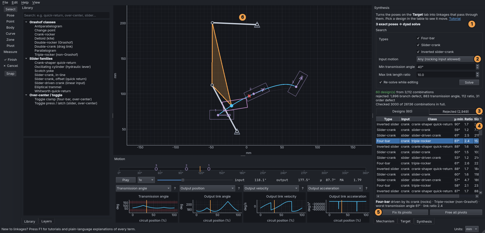
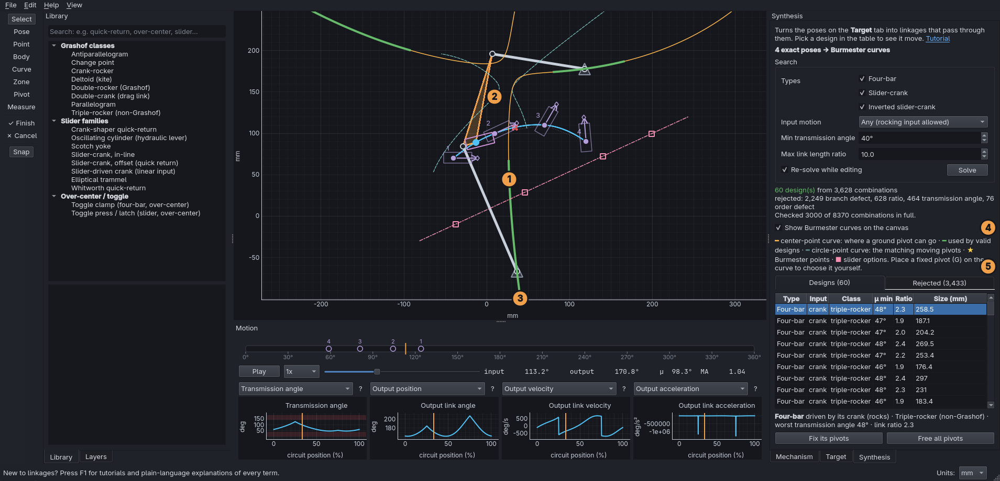

# Find a linkage through 2 to 5 poses

Once you have placed the poses the moving part must reach (see
[Define a motion](03-define-a-motion.md)), the **Synthesis** tab finds
linkages that carry the part through them, in order.

1. **Method**: what kinsyn will do with your target, for example
   *"3 exact poses → dyad solve"*.
2. **Search options**: which mechanism types to try, and what counts as
   good enough.
3. **Designs / Rejected**: what passed every check, and what didn't.
4. **The table**: click a row to see that design move.
5. **Fix its pivots**: keep this design's ground pivots and explore around
   them.
6. **The canvas**: the design, with your part riding on it.

## Step by step

1. Place **2 to 5 poses** with the **Pose** tool (**P**). A body outline
   (**B**) is optional but makes the result much easier to judge.
2. Open the **Synthesis** tab. The search starts by itself and takes about
   a second. Every design in the table passes through every pose
   exactly.
3. **Click a row.** The mechanism appears on the canvas and moves:
   - your part (or an arrow, if you didn't draw one) rides on the moving
     link, so you can watch it pass through the poses;
   - the **timeline** markers move to the input angles where this design
     reaches each pose;
   - the **Mechanism** tab shows its exact dimensions.
4. **Drag a pose** with the **Select** tool (**V**). The design you
   picked follows immediately, and the table refreshes a moment later.

## Reading the table

| Column | Meaning |
|---|---|
| Type | four-bar, slider-crank or inverted slider-crank (see [Slider mechanisms](../concepts/slider-mechanisms.md)) |
| Input | what you drive: a **crank** (rotating link), a **slider**, or a **cylinder** pushing on a swivel |
| Class | its [Grashof class](../concepts/grashof.md): whether the input turns all the way round or rocks |
| μ min | the worst [transmission angle](../concepts/transmission-angle.md) between the first and last pose. Higher is better; above 40° is comfortable |
| Ratio | longest link ÷ shortest link. Lower means more compact and sturdy |
| Size | the longest link |

Click a column header to sort by it, and click it again to reverse the
order. By default the list takes turns between the types, best first, so
the top rows show the best of each kind.

## Narrowing the search

- **Types**: untick the mechanism types you don't want.
- **Input motion**: *Any* allows an input that rocks back and forth
  (fine for a handle, lever or cylinder). Choose *Input must fully rotate*
  for a motor, or a specific Grashof class.
- **Min transmission angle**: designs that get worse than this between the
  poses are rejected (default 40°).
- **Max link length ratio**: rejects awkward, spindly proportions.

You can also put limits on the target itself:

- **Zones** (**Z**): ground pivots must be inside an allowed zone and
  outside keep-out zones. The search places its trial pivots inside the
  allowed zones.
- **Fixed pivots** (**G**): click to put a ground pivot exactly where you
  want one, for example on an existing hinge. Every design then uses it.
  With two fixed pivots, there's only a handful of designs. Drag to fix
  a slider's line of travel instead. With 3 poses only its *direction*
  is kept, because the poses decide where the line runs.

## Exploring around a design you like

Press **Fix its pivots**. The design's ground pivots become fixed pivots
(orange triangles). Now drag one with the **Select** tool: the design
follows, and the Synthesis tab shows straight away whether it is still
valid. If a check fails, the reason appears in red under the table.

**Free all pivots** removes every fixed pivot, so the search can place
them anywhere again. Both can be undone (**Ctrl+Z**).

## Why designs get rejected

The **Rejected** tab lists the most promising designs that failed, with
the reason. The status line counts all of them. The reasons:

- **branch defect**, **order defect**, **circuit defect**: it can't move
  through the poses in order in one continuous motion. See *Defects* in
  [Kinematic synthesis](../concepts/synthesis.md).
- **transmission angle**: it would bind or need large forces somewhere
  between the poses.
- **ratio**, **zone**: proportions or pivot positions outside your limits.
- **input motion**, **change point**: not the kind of input motion you
  asked for, or it sits at the Grashof boundary, where it can flip into
  its other assembly.

If nothing passes, try a lower minimum transmission angle, allow a
rocking input, move the poses a little, or remove a fixed pivot.

## 2 poses vs. 3 poses

- With **3 poses**, choosing a ground pivot fixes the rest of that side of
  the linkage. The search tries ground pivots on a grid around your
  poses (or inside your zones).
- With **2 poses** there is even more freedom, so the search also tries
  several places for each moving pivot. Expect many valid designs. Fixing
  pivots is the quickest way to narrow them down.

## Prescribed timing

If you prescribe the input angle at **every** pose on the timeline, the
input crank must turn by exactly those amounts between the poses. With 3
poses that fixes the input crank completely, and only the other side of
the linkage is searched. Prescribe timing for every pose or for none. If
only some poses have it, the timing is ignored and the status line says
so.

## Changing a design by hand

Edit any dimension in the **Mechanism** tab and the design becomes yours.
It is no longer tied to the poses, and moving a pose won't change it.
Pick a row again to go back.

## 4 and 5 poses: Burmester curves

With 4 poses, ground pivots can no longer go anywhere: only on the
**center-point curve**, which kinsyn draws on the canvas in orange. The
dashed curve shows the matching moving pivots, and the thick green
stretches are the parts used by valid designs. With 5 poses only a few
**Burmester points** (gold stars) are left, where two such curves cross.
See [Burmester curves and points](../concepts/burmester.md).

1. **Center-point curve** (orange): every place a ground pivot can go.
2. **Circle-point curve** (dashed): the matching moving pivots, at pose 1.
3. **Green**: the stretches of the curve used by valid designs.
4. **Show Burmester curves on the canvas**: switch the curves off and on.
5. **Legend**: what each colour means. The pink dash-dot lines are slider
   rails that work for all 4 poses.

- The table works as before: every row uses pivots on the curve.
- To choose a pivot yourself, place a fixed pivot (**G**) on the curve: it
  snaps on. **Fix its pivots** works too, and dragging a fixed pivot
  keeps the design on the curve.
- Slider options appear in pink: a rail direction (dash-dot line through
  the slider's positions), or a swivel point.
- **Show Burmester curves on the canvas** hides them.
- Prescribed timing is ignored with 4 or 5 poses (there is no exact
  solution with it).

5 poses often have **no** exact four-bar. The status line says so; move a
pose a little, or drop to 4 poses.

## What's next

More than 5 poses, and poses with tolerances, need the optimizer (a later
milestone). For now tolerances are ignored and these designs hit every
pose exactly.

See [Kinematic synthesis](../concepts/synthesis.md) for how it works.
